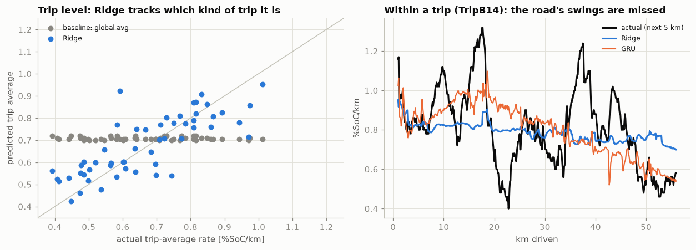

# Findings

> **Draft for the author to rewrite in their own words.** Every number below comes from
> `notebooks/03_models.ipynb`, `notebooks/04_error_analysis.ipynb` or `python -m src.models.run_oracle`
> (outputs in `experiments/`). Source sections are noted after each claim.

**Setup in one paragraph.** 70 real BMW i3 trips (summer and winter, Munich). At every 100 m of a trip, the models
predict the battery consumption rate over the next 5 km (%SoC per km), from which distance-to-empty (DTE) follows as
remaining usable SoC ÷ rate. Models are compared with a naive "global average consumption" baseline using 5-fold
cross-validation grouped by day (53 trips), plus a held-out test set of 13 trips on days never seen in training.

---

## Headline: the models learn *what kind of trip* it is, not *what the road does next*

Every trip has an overall consumption level (a cold winter trip with the heater on costs more than a mild summer one) and
swings around that level as the road changes (a highway stretch, a hill, a traffic jam). Splitting the prediction target
into these two parts shows that the models capture the first and barely touch the second:

| Out-of-sample (CV, 53 trips) | Trip level: R² of trip-average rate | Within trip: correlation with the swings |
|---|---|---|
| Baseline: global average | −0.07 | – (constant) |
| Ridge regression | **0.61** | 0.20 |
| LightGBM | 0.60 | 0.16 |
| GRU (on-device candidate) | 0.54 | 0.20 |

*Source: 04_error_analysis §2.* Inside a trip, the models' predictions move about a third as much as reality does
(standard deviation of within-trip swings: Ridge 0.051 vs actual 0.148 %SoC/km).

**Why it matters:**

- **It explains where the gain comes from.** On cross-validation, Ridge cuts rate error by 24% vs the baseline
  (MAE 0.139 vs 0.183 %SoC/km; 95% bootstrap CI of the difference −0.064 to −0.026), and DTE error from 29.8 to 23.6 km.
  That gain is the trip-level part: temperature, heating and the trip's driving style so far. *(03_models §1, §4)*
- **It explains why the held-out test set did not confirm the gain.** On the 13 test trips, Ridge is only marginally
  better than the baseline (MAE 0.192 vs 0.198; CI −0.041 to +0.018, i.e. inconclusive). Within-trip swings are 44% of the
  target's variance in the CV trips but **82% in the test trips**: the test trips resemble each other overall but are
  bumpy inside, which is exactly the part no model here can predict. *(03_models §4, 04_error_analysis §2)*
- **It sets the ceiling for this approach.** A model that only sees the past cannot know that a highway or a hill starts
  in 2 km. A bigger or sequential model does not fix that: the GRU is no better than Ridge.

## Secondary observations

**1. Machine learning only beats the simple formula at the temperature extremes.** *(04_error_analysis §1)*

| Ambient temperature | Baseline MAE | Ridge MAE |
|---|---|---|
| cold < 5 °C | 0.208 | 0.164 |
| mild 5–15 °C | 0.127 | 0.130 |
| warm > 15 °C | 0.205 | 0.130 |

The global average is effectively mild-weather consumption, so there is nothing to correct in mild weather.

**2. Knowing the road ahead would cut the error by 14%.** In an "oracle" experiment that gives Ridge the *future* 5 km's
mean speed and grade (information a navigation route could supply), rate MAE drops from 0.139 to 0.119 and DTE error from
23.6 to 20.6 km. Speed alone gets most of it (0.125); grade alone less (0.132), since Munich is flat. This is an upper
bound, not a deployed model. *(04_error_analysis §3; `experiments/phase4_oracle.csv`)*

**3. Winter trips start expensive because the cabin is warming up.** In winter trips the heater draws 4.0 kW on average in
the first 2 minutes and about 1.2 kW after 10 minutes, while cabin temperature rises from 14 to 24 °C. This is why "this
trip's average consumption so far" is a poor predictor early in a trip. *(04_error_analysis §4, 02_baselines)*

## Caveats

- **Small data.** 70 trips, 1,337 km. The test set (13 trips) is too small to confirm or rule out the CV improvement, and
  two long trips hold 46% of its prediction points. *(03_models §5)*
- **No trip reaches empty.** "Actual DTE" means *range if the next 5 km's consumption continued*, not an observed run to 0 %.
- **Four-wheeler, flat city.** BMW i3 around Munich; the hill and two-wheeler conclusions do not transfer automatically.
